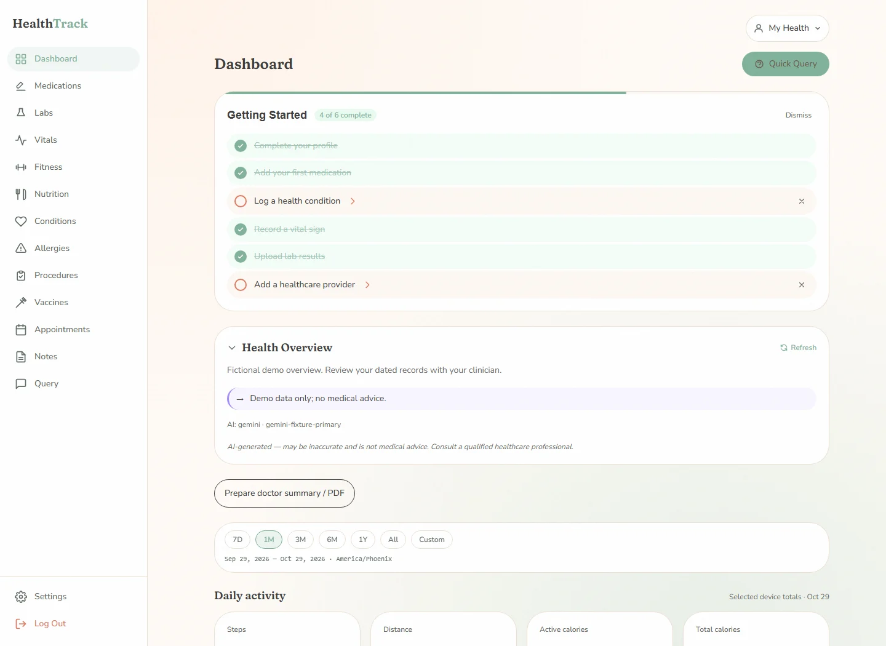
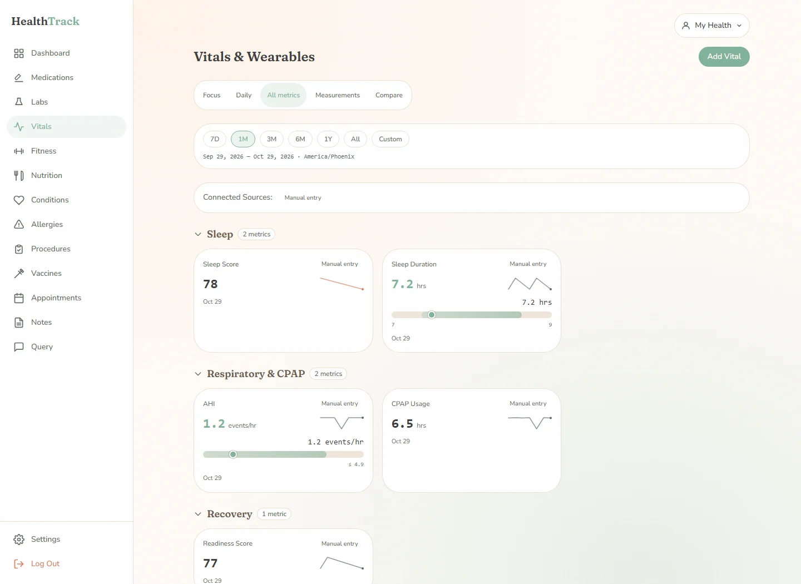
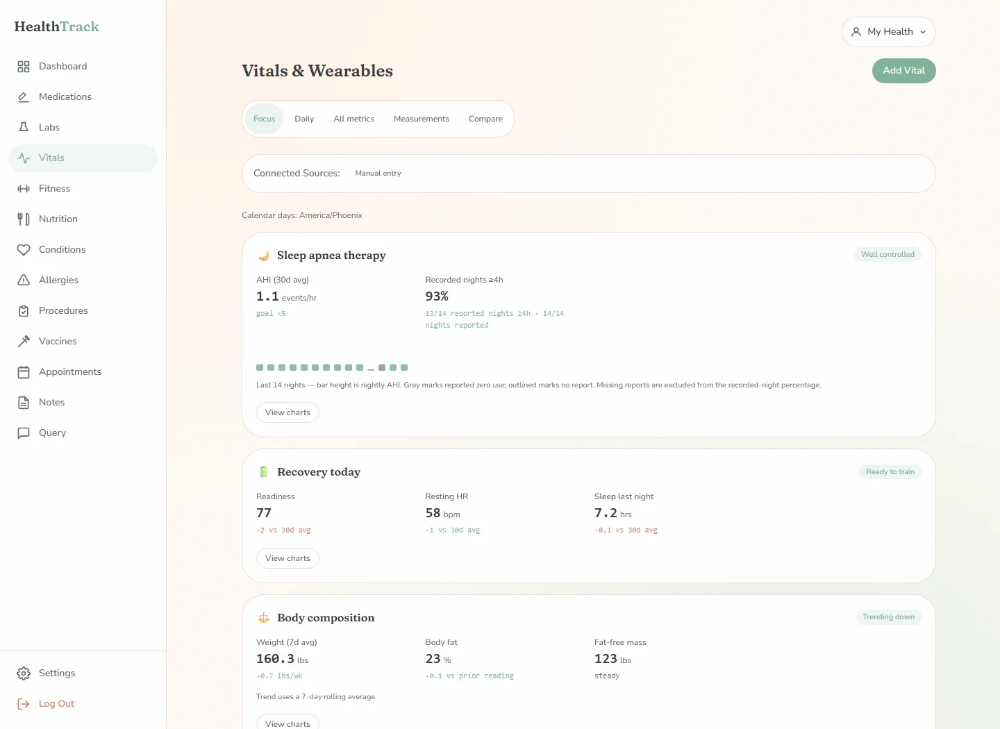
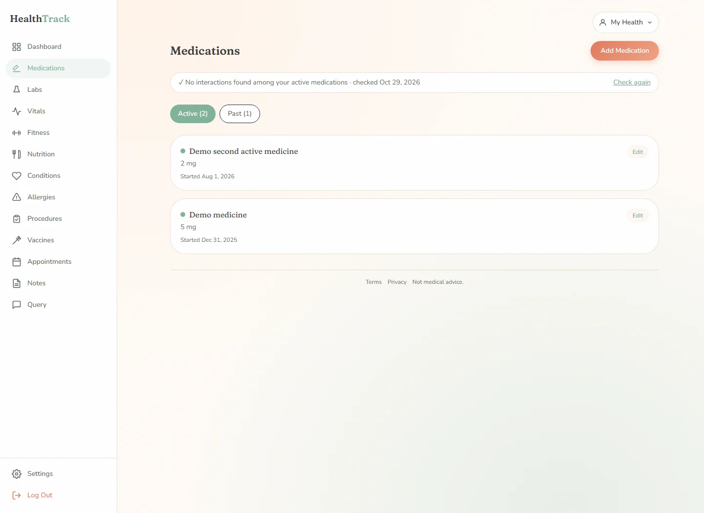
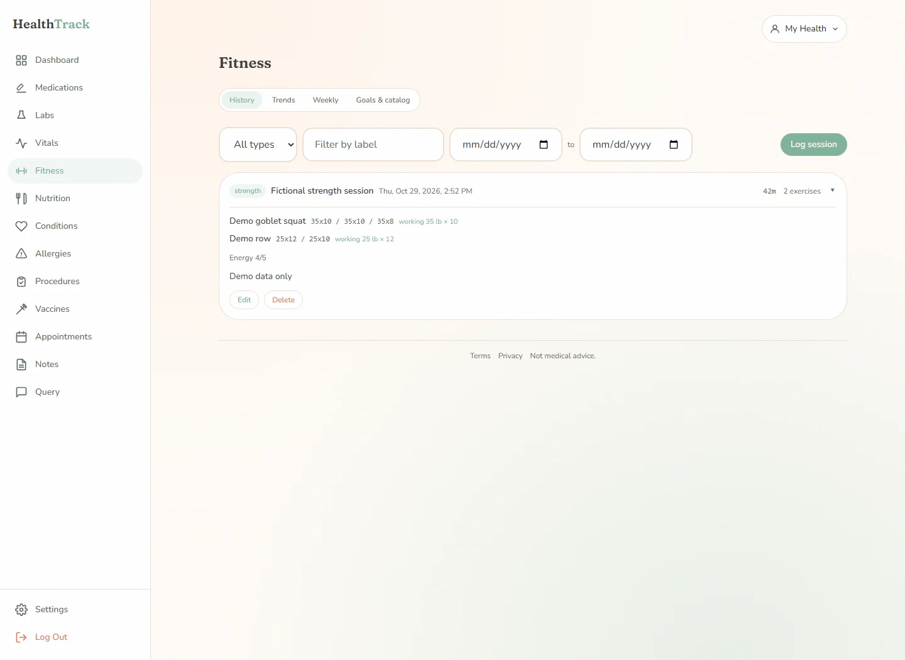
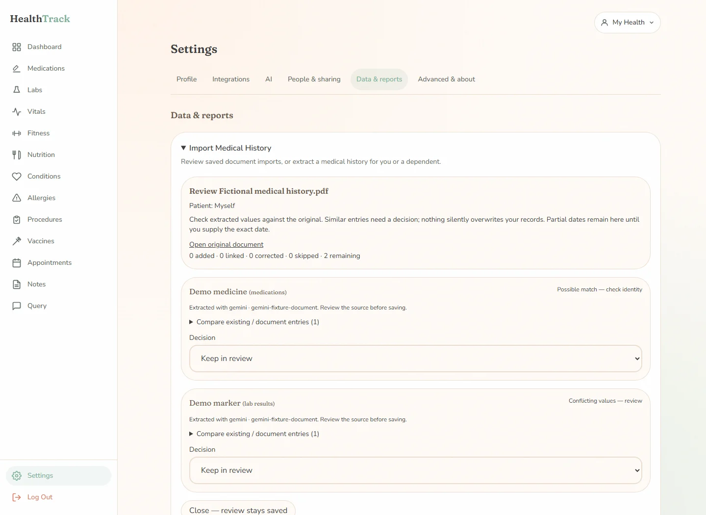

# HealthTrack

[](LICENSE)
[](https://github.com/EzekielTheMad/healthtrack/actions/workflows/ci.yml)

**Self-hosted personal & family health tracker.** Medications, conditions, allergies, labs, vitals, procedures, vaccines, appointments and notes — for you and your dependents — in a single Docker container. Core records and uploads are stored in SQLite and an uploads folder on **your** server. Core tracking works without cloud services. When optional AI features are configured, selected health context or uploaded documents are sent to your account’s chosen Anthropic, OpenAI or Gemini API for processing; see [privacy and security](SECURITY.md).



## Product direction and implementation

HealthTrack brings health records, documents and device data into one
self-hosted place, with review steps for imports and explicit sharing controls.
Victor defines the PRDs, prioritizes features and UX, and guides AI-assisted
implementation. This project includes optional AI features in the product as
well as AI assistance in development.

A product priority is avoiding unnecessary model calls and token use. The
current [dashboard summary flow](src/app/api/health-summary/route.ts) reuses a
cached daily summary, offers manual refresh, and generates a summary when the
cache is missing or stale. Large [medical-history PDFs](src/lib/import/chunk-pdf.ts)
use chunked extraction with warnings and a review step before records are written. These
are implementation choices, not measured savings or clinical validation.

The repository includes unit and integration tests, plus CI lint, build and
container smoke checks. See [release verification](docs/RELEASE.md) for the
checks required for a specific candidate. Review [SECURITY.md](SECURITY.md),
including unverified email identities and legacy share-token limits, before
using multi-user sharing or exposing an instance to the internet. AI output
can be wrong and needs human review.

## Features

Private v2 work includes [aligned metric comparisons](docs/V2.md#comparisons-and-oura-permission-review-200-rc3)
and a [website-first Android companion](docs/ANDROID-ACCEPTANCE.md). The dated
notes record private Unraid rollouts and bounded phone navigation checks; full
phone sync/offline acceptance remains open. These notes do not announce a public
GitHub or registry v2 release. See [current scope and continuation](docs/dashboard/CONTINUE.md)
for reporting ownership and remaining verification limits.

- **Medications** — dosages, schedules, editable start/end dates, active/inactive history, AI interaction checks\*
- **Conditions, allergies, procedures, vaccines** — full clinical history
- **Labs** — collection-dated visits and results, saved corrections with retained originals/audit, reference ranges, and AI-powered PDF parsing of lab and vaccine reports\*
- **Vitals** — blood pressure, heart rate, weight, glucose and more, with reference ranges and trend charts
- **Body measurements** — dedicated Measurements view with independent left/right series, dated changes, presets and sparse trends; see [body measurements](docs/body-measurements.md)
- **Data freshness and sources** — integration receipt/sync status, reconnect warnings, missing-data states and explicit source preferences
- **Family & dependents** — track children or family members under your account, with a transition flow when they grow up
- **Sharing** — share selected sections of your (or a dependent's) health record with another user, with expiry
- **Delegates** — grant another user read-only or read-write access to manage a record
- **Medical-history import\*** — patient-scoped saved reviews for lab PDFs and complete histories; skip, add, link or correct extracted claims with durable outcomes and source evidence. Partial dates and conflicts stay reviewable; failed sections support explicit retry. See [v2 import behavior and limits](docs/V2.md#safe-document-imports)
- **Fitness tracking** — log workouts manually or via the API (set shorthand like `185x5 x3`), with history, trend charts (est. 1RM, PR badges), weekly rollups, goals, and an exercise catalog
- **Appointment preparation** — patient-scoped doctor-summary PDF with medication history and latest collection-dated labs
- **Shared health context** — in-app AI queries and the `read:all` PAT context endpoint (`/api/v1/context`) share dated facts, coverage, provenance and source warnings
- **API access** — personal access tokens with scoped permissions for the REST API (`/api/v1/...`), including read endpoints for every domain
- **Device integrations / bring your own bridge** — push metrics from any device (CPAP, smart scale, watch, CGM, …) via `POST /api/v1/vitals` and `/api/v1/vitals/batch` with idempotent upserts; see [docs/API.md](docs/API.md). Every instance self-documents at `/docs/api` (human cookbook) and `/api/v1/openapi.json` (OpenAPI 3.1) — both public, API-shape only
- **Health Connect ingestion (Android)** — receive Health Connect data from the [Life Dashboard companion app](https://github.com/owen282000/life-dashboard-companion-app) over an HMAC-signed webhook: daily activity totals land in vitals and food-tracker nutrition becomes daily calories and macros. A new integration starts in **inventory** mode — every record is stored and catalogued, but nothing is written to your health data until you approve the exact apps you trust; see [docs/health-connect.md](docs/health-connect.md)
- **AI health assistant\*** — natural-language questions about your data, health summaries
- **Oura Ring sync\*** — sleep, heart rate and activity data
- **Sign in with Google\*** — alongside built-in email/password auth

\* Optional. AI features use per-account keys and tested models in **Settings → AI** ([setup and migration](docs/AI.md)); Google login needs a Google OAuth client and Oura sync needs an Oura OAuth client. Core tracking works without them.

## Screenshots

_All screenshots show a demo account with fictional data._

**Vitals & wearables** — every metric grouped by domain, with trend sparklines, reference-range bars, and per-device source badges. Data flows in from bridges, the API, or manual entry:



**Focus view** — the day-to-day question ("how am I doing?") answered at a glance: recovery verdict, body-composition trend, and weekly activity vs. your 30-day norms:



**Medications** — active/past history with categories, plus AI interaction checks that run automatically when your med list changes:



**Fitness** — workout history with per-set detail, working-set summaries, trends with estimated 1RM and PR badges, weekly rollups and goals:



**Medical-history import** — upload a doctor-provided PDF; AI extracts medications, conditions, allergies, procedures, vaccines and labs in one pass, deduplicates against what's already on record, and imports only what you approve:



## Quick start

```bash
docker run -d \
  --name healthtrack \
  -p 3000:3000 \
  -v ./data:/data \
  -e APP_URL=http://localhost:3000 \
  ghcr.io/ezekielthemad/healthtrack:latest
```

Open http://localhost:3000 and register — **the first user becomes the instance admin**. After that, registration is **invite-only by default**: create single-use invite links under **Settings → People & sharing → Invites** to add family members. (Set `SIGNUPS_ENABLED=true` to open registration to anyone, or `false` to close it completely.)

> **Port 3000 already in use?** Map a different host port and point `APP_URL` at
> it, e.g. `-p 3005:3000` with `-e APP_URL=http://localhost:3005`. The container
> always listens on 3000 internally; only the host side changes.

### Docker Compose

See [`docker-compose.yml`](docker-compose.yml):

```bash
docker compose up -d
```

## Unraid

HealthTrack ships a Community Applications template: [`unraid/healthtrack.xml`](unraid/healthtrack.xml). See [docs/UNRAID.md](docs/UNRAID.md) for install instructions (via CA or manual template URL).

## Adding users & family

Registration is **invite-only by default** — nobody can create an account on
your instance without your say-so. The ways to bring people in:

1. **Invite links** (new accounts) — as admin, go to **Settings → People & sharing → Invites**,
   create a link (optionally note who it's for) and send it. Each link is
   **single-use** and expires after 7 days. The recipient registers with email
   - password; afterwards they can also use "Sign in with Google" on the same
     email (accounts link automatically). Revoke unused links any time.
2. **Dependents** (no account needed) — track children or family members as
   profiles under your own account (**Settings → People & sharing → Family & Dependents**), with
   a transition flow to hand the record over when they grow up.
3. **Delegates** — grant another _account_ read-only or read-write access to
   manage your record (**Settings → People & sharing → Delegate Access**).
4. **Sharing** — share selected sections of a record with another account,
   with expiry (**Settings → People & sharing → Health Sharing**).

Prefer open registration (e.g. a trusted LAN)? Set `SIGNUPS_ENABLED=true`.
Set `SIGNUPS_ENABLED=false` to close registration completely, invites included.

## Configuration

All configuration is via environment variables (see [`.env.example`](.env.example)):

| Variable                                    | Required | Default                        | Purpose                                                                                                                                                                     |
| ------------------------------------------- | -------- | ------------------------------ | --------------------------------------------------------------------------------------------------------------------------------------------------------------------------- |
| `APP_URL`                                   | **yes**  | `http://localhost:3000`        | Absolute URL of the instance — must match what users browse to; used for auth callbacks                                                                                     |
| `AUTH_SECRET`                               | no       | auto-generated to `/data/keys` | Session signing secret                                                                                                                                                      |
| `ENCRYPTION_KEY`                            | no       | auto-generated to `/data/keys` | Encrypts stored OAuth tokens                                                                                                                                                |
| `SIGNUPS_ENABLED`                           | no       | invite-only                    | Unset: first account registers freely (becomes admin), everyone after needs a single-use invite link (Settings → People & sharing → Invites). `true`: open registration. `false`: fully closed |
| `ANTHROPIC_API_KEY` | no | — | Legacy migration source only: an admin can explicitly copy it into their own encrypted settings draft. Does not enable AI automatically. |
| `GOOGLE_CLIENT_ID` / `GOOGLE_CLIENT_SECRET` | no       | —                              | Enables "Sign in with Google"                                                                                                                                               |
| `OURA_CLIENT_ID` / `OURA_CLIENT_SECRET`     | no       | —                              | Enables Oura Ring sync                                                                                                                                                      |
| `OURA_SYNC_ENABLED`                         | no       | `true` when Oura is configured | Startup + recurring native Oura sync toggle                                                                                                                                 |
| `OURA_SYNC_INTERVAL_HOURS`                  | no       | `4`                            | Native scheduler interval; every run self-heals an inclusive 7-day window                                                                                                   |
| `PUID` / `PGID`                             | no       | `99` / `100`                   | Ownership of files under `/data` (Unraid conventions)                                                                                                                       |
| `TZ`                                        | no       | `Etc/UTC`                      | Valid IANA timezone for the container and Oura calendar-date sync windows                                                                                                   |

**Existing installations:** complete the [v2 timezone preflight](docs/V2.md#operator-upgrade-and-restore)
before ingestion or reprocessing. Historical Health Connect normalization used
`America/Phoenix`; this candidate uses configured `TZ` for calendar boundaries.
There is no automatic migration of saved dates. Preserve the timezone matching
the historical record until a deliberate conversion is planned.

### Reverse proxy / HTTPS

HealthTrack serves plain HTTP on port 3000; put your reverse proxy of choice (Nginx Proxy Manager, Caddy, Traefik, Cloudflare Tunnel, …) in front of it for HTTPS. **`APP_URL` must exactly match the URL users browse to** (scheme, host, port) or login callbacks will fail.

### Oura architecture

Oura OAuth tokens are encrypted in each user's `connected_sources` row and are
the only credential store. Manual Sync Now and the native startup scheduler
share the same per-user refresh lock, so concurrent requests cannot rotate a
refresh token twice. The scheduler runs once on Node startup and at the
configured interval (4 hours by default), isolates failures per user, and
backfills an inclusive seven-day self-heal window. The OAuth callback keeps its
30-day initial backfill. HealthTrack writes directly to its canonical vitals
store with `source=oura`; no Notion or bridge writes are involved.

Oura date windows use the HealthTrack `TZ` setting so a sync near UTC midnight
still requests the owner's current local calendar day. `TZ` must be a valid IANA
timezone (for example `America/New_York`); the portable default is `Etc/UTC`.

**When using a public proxy, choose one hostname.** If your proxy answers on both `example.com` and `www.example.com` (a common default), pick one, put it in `APP_URL`, and have the other redirect to it. Auth cookies are scoped to the exact host that set them, while OAuth redirect URIs are built from `APP_URL` — so a visitor who starts on the hostname you _didn't_ configure gets sent back to the one you did, without their cookie, and Google sign-in fails with `?error=state_mismatch`. HealthTrack redirects browser page requests to `APP_URL`'s hostname (API routes under `/api/` are left alone, as are localhost and LAN addresses).

### Authentication & OAuth

Built-in **email/password** sign-in works anywhere, including a bare LAN IP — nothing extra to configure. The optional social logins have provider-specific requirements:

- **Sign in with Google** requires a **public HTTPS URL on a real hostname**. Google's OAuth rejects `http://` and raw IP-address redirect URIs (only `http://localhost` is exempt), so it will **not** work against something like `http://192.168.1.50:3000` — you must front the app with HTTPS (reverse proxy or tunnel) and set `APP_URL` to that address. Then, in the **Google Cloud Console** OAuth client, add this Authorized redirect URI:

  ```
  APP_URL/api/auth/callback/google
  ```

- **Oura Ring** is more permissive (a LAN IP is fine). Register its redirect URI in the **Oura developer portal** — _not_ the Google console; they are separate providers with separate credentials:

  ```
  APP_URL/api/oura/callback
  ```

In every case `APP_URL` must exactly match the URL your browser uses (scheme, host **and** port), or the OAuth round-trip fails. Restart the container after changing `APP_URL`. The first user to sign in — by any method — becomes the admin.

### Backup

Everything lives under `/data`: the SQLite database (`healthtrack.db`), uploaded PDFs (`uploads/`) and auto-generated secrets (`keys/`). To back up: stop the container, copy the `/data` directory, start it again. Restore is the reverse.

## Development

```bash
npm install
npm run dev     # http://localhost:3000, state lands in ./data
npm test        # vitest
npm run lint
npm run build
```

The gym-import regression dataset is [independently synthetic](scripts/fixtures/gym-export/README.md). Never commit real health exports, source-page links or identifying notes as test fixtures.

Local development state (SQLite db, uploads, generated keys) lives in `./data` (override with `DATA_DIR`). Database tests run in the node environment — see existing `*.test.ts` files for the environment pragma convention.

For local **production-mode** testing, explicitly pin `DATA_DIR` to an isolated
scratch directory: the default switches to `/data` when `NODE_ENV=production`,
so otherwise you may test against a different database. Never use a live health
data directory as a test fixture.

Container implementation, image workflow, project release checks and historical
release lessons are in [docs/RELEASE.md](docs/RELEASE.md). This is documentation,
not deployment or publication authorization.

### Medical-history extraction

Large medical-history PDFs are split with `pdf-lib` into 25-page chunks once
past the threshold in [`chunk-pdf.ts`](src/lib/import/chunk-pdf.ts). Extraction
claims are retained for patient-scoped review; a matching name or richer
payload does not silently discard other claims. A failed chunk becomes
a page-range warning; if every chunk fails, extraction fails. Review warnings
for missing information rather than treating a partial result as complete.
`ANTHROPIC_MODEL_EXTRACTION` can differ from the reasoning model to manage cost.
Long extraction requests must fit your proxy's timeout; the application route's
duration setting does not override an upstream proxy limit.

See [v2 candidate notes](docs/V2.md) for implemented workflows, safe-import
actions and limitations, operator upgrade/restore requirements and pending
release validation. These notes do not establish the revision running on an
existing server.

## Disclaimer

HealthTrack helps you **organize** health information. It is **not a medical device and does not provide medical advice**, diagnosis or treatment — always consult a qualified healthcare professional. AI-generated content can be wrong. You run this software self-hosted, on your own infrastructure, at your own responsibility; review [SECURITY.md](SECURITY.md) before exposing an instance to the internet.

## License

[MIT](LICENSE)
